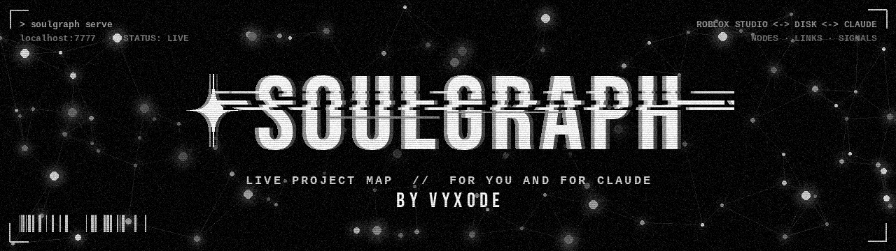
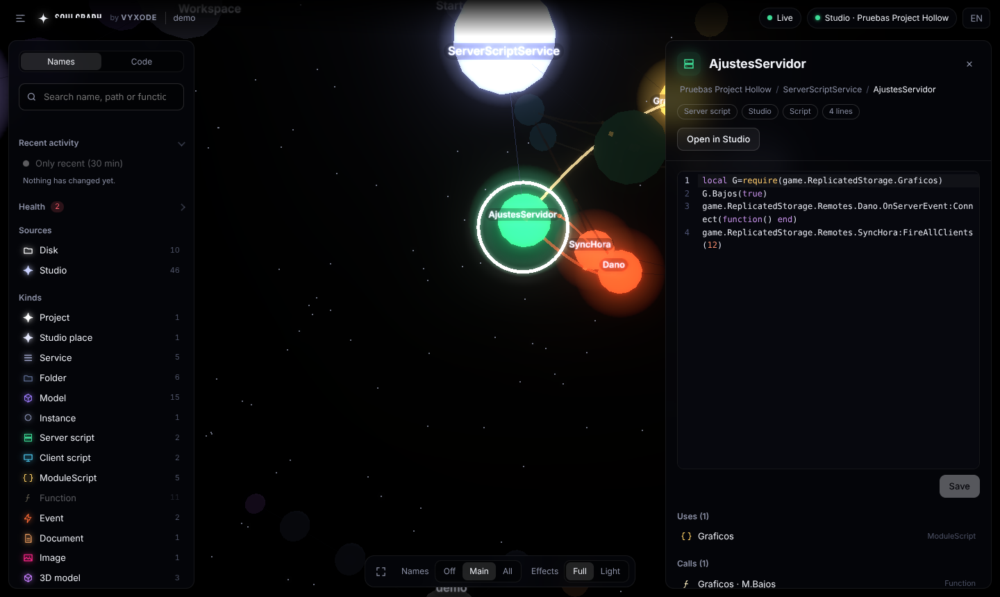

<p align="center"></p>

**A live map of your project, for you and for Claude.**
**Un mapa en vivo de tu proyecto, para ti y para Claude.**

SoulGraph turns a project, meaning the files on disk **and** the Roblox Studio places you have open,
into a 3D neural-network graph you can filter, search, open and edit in real time. It also gives Claude
the same map, through tools and a single `MAP.md`, so Claude understands the whole project without
opening files one by one.

SoulGraph convierte un proyecto, es decir, los archivos del disco **y** los lugares de Roblox Studio que
tengas abiertos, en un grafo 3D tipo red neuronal que puedes filtrar, buscar, abrir y editar en tiempo
real. Además le da a Claude el mismo mapa, con herramientas y un único `MAP.md`, para que entienda todo
el proyecto sin abrir archivo por archivo.



---

## What it does / Qué hace

| | English | Español |
|---|---|---|
| 🧠 | **Claude tools (MCP):** overview, find, code search, node details, health, edit, open in Studio. | **Herramientas para Claude (MCP):** resumen, buscar, buscar en el código, detalles, salud, editar y abrir en Studio. |
| 🗺️ | **`.soulgraph/MAP.md`:** every script, function, `require`, call and event in one read. | **`.soulgraph/MAP.md`:** cada script, función, `require`, llamada y evento en una lectura. |
| 🌌 | **3D panel on `localhost:7777`:** glowing nodes, with "impulses" along requires and events. | **Panel 3D en `localhost:7777`:** nodos con brillo e "impulsos" por los `require` y los eventos. |
| ⚡ | **Firing neurons:** whatever changes flashes and pulses through its connections; there's also a recent-activity filter. | **Neuronas que se disparan:** lo que cambia destella y se propaga; también hay un filtro de actividad reciente. |
| ✏️ | **Real editor:** Luau highlighting, line numbers, search/replace and conflict-safe saves to disk or Studio. | **Editor de verdad:** colores Luau, números de línea, buscar/reemplazar y guardado seguro en disco o Studio. |
| 🔎 | Search by name or **inside the code**, and jump straight to the line. | Busca por nombre o **dentro del código**, y salta directo a la línea. |
| 🔗 | **Function graph:** which script calls `Module.function`. | **Grafo de funciones:** qué script llama a `Modulo.funcion`. |
| 📡 | **RemoteEvents:** who fires each event and who listens to it, client ↔ server. | **RemoteEvents:** quién dispara cada evento y quién lo escucha, cliente ↔ servidor. |
| 🩺 | **Health:** broken requires, circular dependencies, duplicate names, unused modules, events with no sender or listener. | **Salud:** `require` rotos, dependencias circulares, nombres repetidos, módulos sin usar, eventos sin emisor u oyente. |
| 🎛️ | **Full or light effects:** picked automatically for your computer; light mode is flat and fast. | **Efectos completos o ligeros:** se eligen solos según tu ordenador; el modo ligero es plano y rápido. |
| 🧩 | **Readable at scale:** services gather together, repeated models collapse into "N ×" nodes, functions appear when you open their module. | **Legible aunque sea enorme:** los servicios se agrupan, los modelos repetidos se juntan en nodos "N ×" y las funciones aparecen al abrir su módulo. |
| 🎮 | **Roblox Studio plugin:** live sync of several open places, with edits applied in Studio and undoable with Ctrl+Z. | **Plugin de Roblox Studio:** sincroniza en vivo varios lugares abiertos, y lo que editas se aplica en Studio con Ctrl+Z. |

---

## Quick start

**Requirements:** [Node.js 20+](https://nodejs.org). No `npm install` needed.

```bash
git clone https://github.com/vyxode/soulgraph.git
node soulgraph/cli/soulgraph.js serve path/to/your/project
```

The panel opens at http://localhost:7777 and `.soulgraph/` appears inside your project.

**Roblox Studio:** copy `roblox/SoulGraph.plugin.lua` into Studio's plugins folder
(*Plugins → Plugins Folder*), restart Studio and allow the localhost permission the first time.
A **SoulGraph** button in the Plugins tab turns sync on and off.

**Claude Code:** install the plugin, which adds the skill and the MCP tools. The tools start the panel
on their own when Claude opens the project.

```text
/plugin marketplace add vyxode/soulgraph
/plugin install soulgraph@vyxode
```

**Claude desktop app:** add SoulGraph as a local MCP server (*Settings → Developer → Edit config*):

```json
{
  "mcpServers": {
    "soulgraph": {
      "command": "node",
      "args": ["C:/path/to/soulgraph/cli/soulgraph.js", "mcp", "D:/path/to/your/project"]
    }
  }
}
```

No Claude plugin? `node soulgraph/cli/soulgraph.js init path/to/project` adds a note to the project's
`CLAUDE.md` so any Claude session reads the map first.

## Inicio rápido

**Necesitas:** [Node.js 20+](https://nodejs.org). No hace falta `npm install`.

```bash
git clone https://github.com/vyxode/soulgraph.git
node soulgraph/cli/soulgraph.js serve ruta/a/tu/proyecto
```

El panel se abre en http://localhost:7777 y aparece la carpeta `.soulgraph/` dentro de tu proyecto.

**Roblox Studio:** copia `roblox/SoulGraph.plugin.lua` a la carpeta de plugins de Studio
(*Plugins → Plugins Folder*), reinicia Studio y acepta el permiso de localhost la primera vez.
El botón **SoulGraph** de la pestaña Plugins activa o pausa la sincronización.

**Claude Code:** usa los dos comandos `/plugin` de arriba. Las herramientas encienden el panel solas
cuando Claude abre el proyecto.

**App de escritorio de Claude:** añade SoulGraph como servidor MCP local con el JSON de arriba
(*Ajustes → Desarrollador → Editar configuración*).

¿Sin plugin? `node soulgraph/cli/soulgraph.js init ruta/al/proyecto` añade un aviso al `CLAUDE.md` del proyecto.

---

## Claude tools / Herramientas para Claude

| Tool | What it does / Qué hace |
|---|---|
| `soulgraph_overview` | Places, counts, health and every script. Start here. / Lugares, cifras, salud y todos los scripts. |
| `soulgraph_find` | Find by name, path or defined function. / Buscar por nombre, ruta o función. |
| `soulgraph_search_code` | Text search inside every script, returning `path:line`. / Buscar texto en todo el código. |
| `soulgraph_node` | One node with its links and source. / Un nodo con sus conexiones y su código. |
| `soulgraph_health` | Every health issue. / Todos los avisos de salud. |
| `soulgraph_edit` | Replace exact text in a script or file, live in Studio. / Reemplazar texto en un script o archivo, en vivo en Studio. |
| `soulgraph_open_in_studio` | Select an instance in Studio and open a script at a line. / Seleccionar en Studio y abrir un script en una línea. |

## Commands / Comandos

```text
soulgraph [serve] [folder] [--port 7777] [--no-open]   Live panel + map / Panel en vivo + mapa
soulgraph build [folder]                               Regenerate .soulgraph/ once / Regenera una vez
soulgraph init [folder]                                Config + CLAUDE.md note / Config + aviso en CLAUDE.md
soulgraph mcp [folder]                                 MCP server for Claude / Servidor MCP para Claude
```

## What it writes / Qué genera

```text
your-project/
├─ soulgraph.config.json      optional settings / ajustes opcionales
└─ .soulgraph/
   ├─ MAP.md                  for Claude: everything in one read / para Claude: todo en una lectura
   ├─ graph.json              every node and link, one per line / cada nodo y enlace, uno por línea
   ├─ studio.json             last Studio snapshot / última foto de Studio
   └─ studio/<place>/         read-only mirror of Studio scripts / copia de solo lectura de los scripts
```

## Configuration / Configuración

`soulgraph.config.json` (all optional / todo opcional):

```json
{
  "port": 7777,
  "ignore": ["Builds", "Temp"],
  "maxTextBytes": 1048576,
  "sampleBytes": 65536
}
```

If you change the port, change `SERVER_URL` at the top of the Studio plugin too.
Si cambias el puerto, cambia también `SERVER_URL` al principio del plugin de Studio.

---

## How it works / Cómo funciona

```text
 disk ──► scanners/disk.js ─┐                          ┌─► MAP.md / graph.json / studio/  (Claude)
                            ├─► analyzers ─► graph.js ─┤
 Studio plugin ─► studio.js ┘   (per window)           ├─► server.js ─► SSE ─► panel      (you / tú)
            ▲                                          └─► mcp.js ─► tools               (Claude)
            └──────── long-poll commands (edit, open, props) ◄──┘
```

| File | Role / Función |
|---|---|
| `src/scanners/disk.js` | Walks the folder and caches analysis by size + mtime. / Recorre la carpeta con caché. |
| `src/studio.js` | Studio bridge: one session per window, with sources, command queue and mirror. / Puente con Studio, una sesión por ventana. |
| `src/analyzers/` | One file per language: symbols, requires, calls and events. / Un archivo por lenguaje. |
| `src/graph.js` | Nodes, functions, links and health issues. / Nodos, funciones, enlaces y salud. |
| `src/map-writer.js` | Writes `.soulgraph/`. / Escribe `.soulgraph/`. |
| `src/server.js` | HTTP API and Server-Sent Events, with zero dependencies. / API y SSE sin dependencias. |
| `src/mcp.js` | MCP server, which starts the panel if needed. / Servidor MCP, que enciende el panel si hace falta. |
| `src/search.js` | Code search. / Búsqueda en el código. |
| `public/` | The panel: `app.js` (data and filters), `view.js` (3D visuals and quality), `inspector.js`, `icons.js`; 3d-force-graph and CodeMirror bundled to work offline. / El panel, empaquetado sin internet. |
| `roblox/` | Studio plugin. / Plugin de Studio. |
| `skills/soulgraph/` | The Claude skill. / La skill de Claude. |

## Extending / Ampliarlo

- **New language / Nuevo lenguaje:** add `src/analyzers/<lang>.js` exporting
  `{ name, test(info), analyze(text, info) → { symbols, imports, calls, sends, listens, refs } }`
  and register it in `src/analyzers/index.js`. The graph links everything by name on its own.
- **New file type / Nuevo tipo de archivo:** add its extension to `src/kinds.js` and a color to `public/util.js`.
- **New live source / Nueva fuente en vivo** (Blender, Unity…): follow the pattern in `src/studio.js`,
  which takes a tree and sources over HTTP and feeds `buildGraph`.
- **New Claude tool / Nueva herramienta para Claude:** add an entry to `TOOLS` in `src/mcp.js`.
- **New panel language / Nuevo idioma del panel:** copy a block in `public/i18n.js`.
- **Panel libraries / Librerías del panel:** `npm install && npm run build:vendor` rebuilds `public/vendor/`.

Run the tests / Ejecuta las pruebas: `npm test`.

## Security / Seguridad

- The server only listens on `127.0.0.1`. / Solo escucha en `127.0.0.1`.
- Requests with a foreign `Host` or `Origin` are rejected, so websites can't touch your files.
  / Se rechazan `Host` u `Origin` ajenos: ninguna web puede tocar tus archivos.
- File ids can never resolve outside the project folder. / Las rutas nunca salen de la carpeta del proyecto.
- Saves check the version you started from; if it changed meanwhile, you choose which version wins.
  / Al guardar se comprueba la versión de partida; si cambió, eliges qué versión gana.

## License / Licencia

[MIT](LICENSE) © Vyxode
